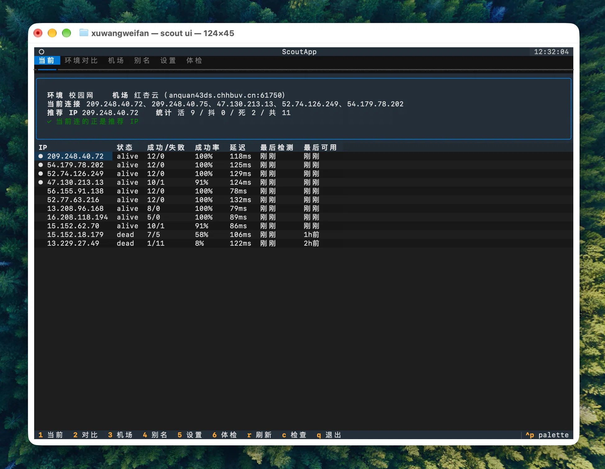

# scout

这个工具是因为一个具体问题做的：**在家用代理正常，一到学校就连不上。**

排查下来发现没那么简单。有时候确实像是校园网那边的问题（换到家里或热点就好了），
但更多时候是机场自己的 IP 池在变——同一个域名每次解析出来的 IP 不一样，
有的早就死了，抽到就 timeout。表现出来就是「时好时坏」，光靠感觉分不清是哪一种。

Clash 不保存这些历史，也不告诉你现在连的是哪个 IP、好还是坏。scout 就是给它配一个
「病历本」：按网络环境（家 / 学校 / 热点）记录每个 IP 的状态，卡的时候能查出该换成哪个。

想做到三步：**① 记录 + 找出能用的**（已做）、**② 一键固定到 Verge**（手动能做，自动化待补）、
**③ IP 失效时自动换**（规划中）。

> 纯只读：只发 DNS 查询和 TCP 握手，不改任何 Clash 配置、不碰系统文件。

---

## 界面预览



六个 Tab：当前 / 环境对比 / 机场 / 别名 / 设置 / 体检。

## 快速开始

```bash
cd clash-scout
python3 -m pip install --user -e . --no-build-isolation
```

最常用的三条：

```bash
scout current     # 看现在连的 IP 好不好
scout check       # 采样 + 探测 + 记录一轮
scout compare     # 同一批 IP 在不同网络下的对比
scout ui          # 打开终端界面（需先装 textual）
```

## 文档

- **[背景与设计](docs/background.md)** —— 为什么做、踩过的坑、设计取舍
- **[完整用法](docs/usage.md)** —— 所有命令、输出示例、状态含义、怎么把稳定 IP 固定下来
- **[内部细节](docs/internals.md)** —— 数据存哪、配置项、扩展方向

## License

[MIT](LICENSE)
